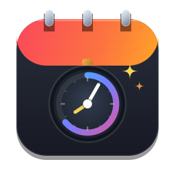

# Event Countdown

<p align="center">
  
</p>

<p align="center">
  <strong>A configurable event countdown desklet for Linux Mint Cinnamon.</strong>
</p>

<p align="center">
  <a href="#features">Features</a> •
  <a href="#installation">Installation</a> •
  <a href="#configuration">Configuration</a> •
  <a href="#project-structure">Project Structure</a> •
  <a href="#license">License</a>
</p>

---

## Features

- **Target date and optional time** — set the event day, month and year, plus an hour and minute if needed.
- **Multiple views** — breakdown cards for years / months / weeks / days (and hours when a time is set), or a single-unit view in years, months, weeks, days or hours.
- **Two number formats** — decimal (e.g. `1.5 Ay`) or sub-unit (e.g. `1 Ay 15 Gün`), toggled with the `½` / `▾` icon button.
- **Quick mode switch** — the `⇋` icon button cycles through the available modes and saves the selection in desklet settings.
- **Bilingual interface** — Turkish and English labels, with localized month names.
- **Appearance controls** — compact mode, font size, custom header title, background / card / text / accent / border colors, opacity, border width and corner radius.
- **Flexible sizing** — the configured width is a minimum only; the desklet grows with its content, so long values never get clipped.
- **Live updates** — settings changes re-render the desklet immediately and the countdown refreshes every 30 seconds.
- **Clean lifecycle** — timers, idle callbacks and settings bindings are released when the desklet is removed.

---

## Installation

```bash
git clone https://github.com/egemngyk/event-countdown.git
cd event-countdown
chmod +x install.sh
./install.sh
```

The script copies the desklet to `~/.local/share/cinnamon/desklets/event-countdown@egemngyk` and reloads it in Cinnamon over DBus.

To add it to the desktop:

1. Right-click the desktop or panel and choose **Desklets** (Masaüstü Araçları).
2. Find **Event Countdown** in the list and click **+**.
3. Right-click the desklet and choose **Configure** to set the event and appearance.

To update, pull the latest changes and run `./install.sh` again. If the settings schema has changed, run `./install.sh --reset-settings` to clear the cached settings. To remove the desklet, run `./install.sh --uninstall`.

---

## Configuration

Settings are split into two pages in Cinnamon's configure dialog:

| Page | Section | What it controls |
| --- | --- | --- |
| Event / Olay | Event Information | Event name and custom header title |
| Event / Olay | Target Date | Required day, month and year |
| Event / Olay | Target Time | Optional hour and minute |
| Event / Olay | Display Mode | Breakdown cards or a single unit, decimal / sub-unit format |
| Appearance / Genel | Appearance, Size, Colors, Frame, Title | Language, compact mode, minimum size, font size, colors, opacity, border, corner radius and title |

The `⇋` and `½` / `▾` buttons on the desklet itself change the display mode and number format without opening the settings dialog; their state is saved in the desklet configuration.

---

## Project Structure

```text
event-countdown/
├── event-countdown@egemngyk/
│   ├── desklet.js              # Countdown logic, UI rendering and settings bindings
│   ├── settings-schema.json    # Cinnamon settings schema and two-page boxed layout
│   ├── metadata.json           # Desklet UUID, name and version
│   ├── stylesheet.css          # CSS classes used by the desklet
│   └── icon.png                # Desklet icon (128x128)
├── install.sh                  # Install / update / uninstall helper
├── manifest.json               # Cinnamon spices submission metadata
├── LICENSE                     # MIT License
└── README.md                   # This documentation
```

---

## License

This project is licensed under the [MIT License](LICENSE).
